

EVERBOUND · The Living Adventurers Guild

EB-03

<h1 class="title">Races and Lineages</h1>

Version 1.0 · November 23, 2026 · APPROVED

The 12 races and 60 lineages, with the approved reference art.

APPROVED decided by the founders &nbsp; DRAFT proposed, expect changes after playtesting

<b>Related documents</b><ul><li><b>EB-01</b> Core Rules</li><li><b>EB-04</b> Racial Skill Trees</li><li><b>EB-05</b> Lineage × Specialization Synergies</li></ul>

**Version:** 1.0  
**Status:** Approved roster and approved lineage art (Lineage Handbook)  
**Scope:** 12 base races · 5 lineages per race · **60 playable lineages**  
**Companion design:** Everbound class and specialization system

---

## 1. Purpose and terminology

This compendium establishes the **lineage/ancestry choices** for each of Everbound's 12 playable base races. A lineage is a recognizable ancestral variety, body/material type, or (for humans) regional heritage—not a class, subclass, or skill-tree name. Each lineage has a visual or cultural identity and a **core natural specialty** to guide later racial skill design.

- **Race:** What kind of being a character is.
- **Lineage:** The ancestry, biological variety, constructed body type, or heritage within that race.
- **Class:** The character's trained role. Everbound's six official classes are **Vanguard, Wildstrider, Shadowblade, Luminary, Arcanist, and Resonant**.
- **Class specialization:** A distinct advanced playstyle within the selected class.
- **Racial skill tree:** Future skills developed from the selected lineage's innate traits and adapted strengths.

**Character-building rule:** Any race and lineage may choose any of the six official classes. A lineage specialty describes an area of aptitude, **not an automatic granted power or class restriction**. Numerical bonuses, unlock levels, active abilities, limitations, and capstones will be defined in the subsequent racial skill-tree design phase.

**Art consistency:** Preserve Everbound's approved **Painterly JRPG** character direction and base-race anatomy. Lineage variation should remain recognizable within the base race; skin, hair, feather, eye, and scale colors are not automatically gameplay powers.

---

## 2. Roster at a glance

| Base race | Number of lineages | Lineages |
|---|---:|---|
| Human | 5 | Highlander; Coastlander; Plainsfolk; Dune Dweller; Frostlander |
| Elf | 5 | High Elf; Wood Elf; Moon Elf; Deep Elf; Frost Elf |
| Dwarf | 5 | Mountain Dwarf; Hill Dwarf; Deep Dwarf; Ember Dwarf; Crystal Dwarf |
| Halfling | 5 | Hillfoot; Woodfoot; Riverfoot; Marshfoot; Cavefoot |
| Orcborn | 5 | Mountain Orc; Steppe Orc; Ash Orc; Marsh Orc; Frost Orc |
| Beastkin | 5 | Wolfkin; Foxkin; Catkin; Rabbitkin; Bearkin |
| Drakari | 5 | Wyrmkin; Serpentkin; Drakekin; Crystaldrake; Thornscale |
| Ashborn | 5 | Cinderborn; Duskhorn; Paleash; Thornhorn; Smokeborn |
| Sylph | 5 | Butterfly Sylph; Moth Sylph; Dragonfly Sylph; Cicada Sylph; Lacewing Sylph |
| Tidekin | 5 | Riverkin; Sharkkin; Reefkin; Raykin; Deepkin |
| Skyborn | 5 | Hawkin; Eaglekin; Falconkin; Owlkin; Ravenkin |
| Forgeborn | 5 | Stoneforged; Ironforged; Bronzeforged; Woodforged; Crystalforged |
| **TOTAL** | **60** | **12 races × 5 lineages** |

---

## 3. Human

**Base identity:** Adaptable human communities with broad variation in appearance and no required supernatural anatomy. Human lineages represent **regional heritages and learned traditions**, not biologically fixed traits.

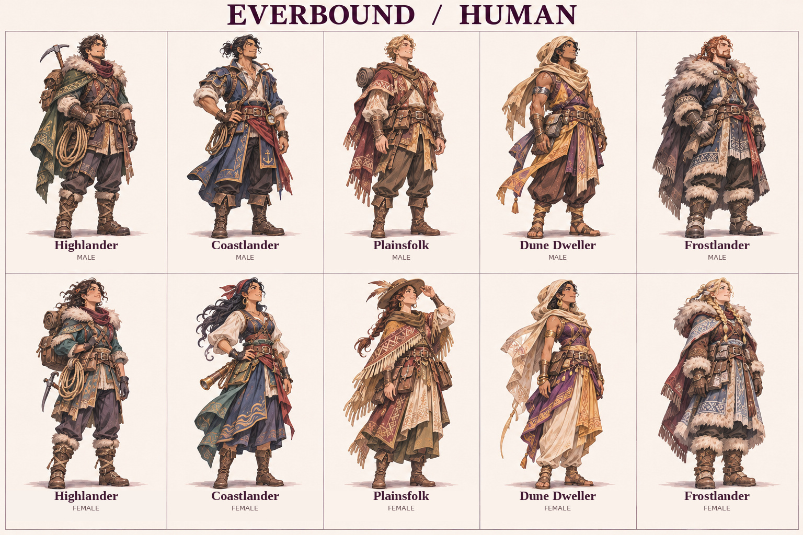
Human lineages — approved reference art (male and female)

| Lineage | Identity / visual cues | Core natural or learned specialty | Future skill-tree direction |
|---|---|---|---|
| **Highlander** | Origin in mountain settlements; practical cold-weather climbing equipment | Endurance, climbing | Vertical traversal, difficult-terrain travel, persistence |
| **Coastlander** | Coastal settlements; seafaring dress and equipment | Sailing, swimming | Navigation, water survival, shipboard movement |
| **Plainsfolk** | Open grassland and caravan communities | Travel, navigation | Routefinding, long-distance travel, awareness |
| **Dune Dweller** | Arid-region communities; heat-adapted clothing and equipment | Heat survival, resource conservation | Heat management, waterfinding, expedition logistics |
| **Frostlander** | Northern settlements; layered winter gear and traditions | Cold-weather survival, perseverance | Cold-environment resilience, survival, morale |

**Design note:** Human appearance is freely customizable; ancestry does not prescribe skin tone or physical features. Lineage specialties should reflect background and training.

## 4. Elf

**Base identity:** Tall, slender humanoids with pointed ears, luminous irises, and sensitivity to the natural and magical world.

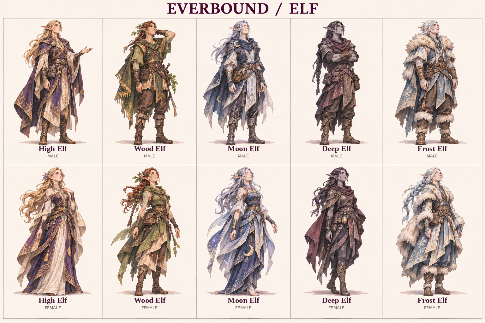
Elf lineages — approved reference art (male and female)

| Lineage | Identity / visual cues | Core specialty | Future skill-tree direction |
|---|---|---|---|
| **High Elf** | Luminous irises, refined features, long-lived magical traditions | Arcane sensitivity | Spell sensing, magical understanding, resonance |
| **Wood Elf** | Forest-adapted traditions, earth-toned markings and dress | Forest awareness, stealth | Tracking, wilderness concealment, woodland traversal |
| **Moon Elf** | Cool-toned appearance, prominent reflective irises | Night perception | Low-light detection, nighttime awareness, hidden-threat detection |
| **Deep Elf** | Dim-environment adaptations, subdued coloration | Darkness adaptation | Underground perception, shadow navigation, sensory focus |
| **Frost Elf** | Cold-region adaptations, pale or frostlike markings | Cold resilience | Harsh-weather endurance, environmental survival, composure |

**Design note:** Lineage is not a personality, moral alignment, or mandatory class assignment.

## 5. Dwarf

**Base identity:** Short, broad, strong humanoids with dense builds, substantial hands, and traditions of craft and earth knowledge.

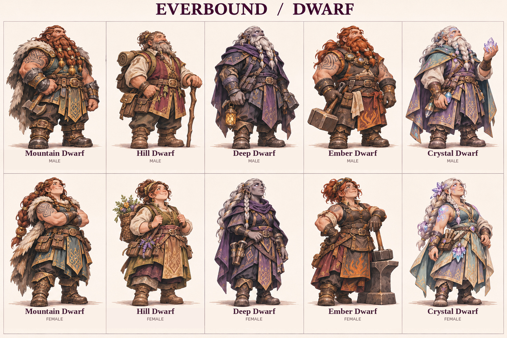
Dwarf lineages — approved reference art (male and female)

| Lineage | Identity / visual cues | Core specialty | Future skill-tree direction |
|---|---|---|---|
| **Mountain Dwarf** | Broad frame, dense musculature | Strength, endurance | Load bearing, sturdy footing, prolonged exertion |
| **Hill Dwarf** | Compact build, steady gait, sturdy feet | Stamina, balance | Grounded movement, resistance to displacement, persistence |
| **Deep Dwarf** | Dim-adapted eyes, muted coloring | Underground perception | Cave navigation, hazard recognition, low-light sensing |
| **Ember Dwarf** | Ruddy or ash-grey features, heat-adapted heritage | Heat tolerance | Forge and volcanic environments, heat resilience |
| **Crystal Dwarf** | Subtle mineral markings, reflective irises | Resonance, mineral sensing | Geological perception, vibration awareness, material analysis |

**Design note:** All lineages retain recognizable adult Dwarf proportions; material features are subtle, not a replacement with a constructed body.

## 6. Halfling

**Base identity:** Compact adult humanoids, roughly three feet tall, known for dexterity and practical ingenuity.

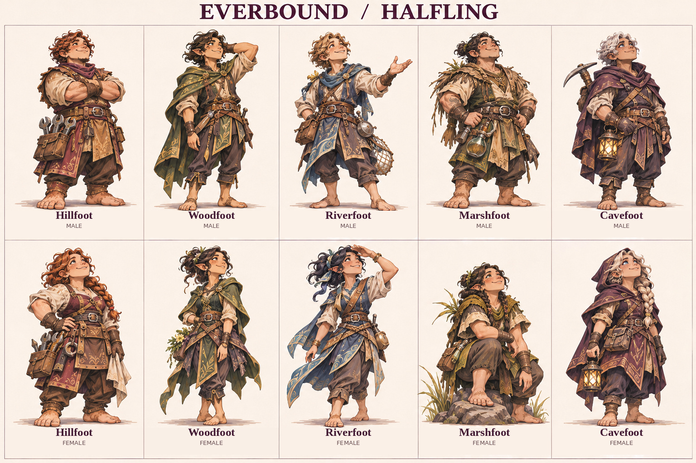
Halfling lineages — approved reference art (male and female)

| Lineage | Identity / visual cues | Core specialty | Future skill-tree direction |
|---|---|---|---|
| **Hillfoot** | Compact, sturdy build; broad feet | Endurance, balance | Sure footing, long treks, stable movement |
| **Woodfoot** | Leaner build, nimble hands and feet | Stealth, climbing | Concealment, climbing, natural cover |
| **Riverfoot** | Flexible feet, streamlined movement | Swimming, agility | Water movement, nimble repositioning |
| **Marshfoot** | Wide-set feet, strong lower legs | Difficult-terrain movement | Mud, marshes, soft-ground traversal |
| **Cavefoot** | Low-light-adapted eyes, compact build | Underground navigation | Tunnel navigation, dark-area awareness, confined spaces |

**Design note:** Halflings remain clearly adult, not childlike or chibi.

## 7. Orcborn

**Base identity:** Tall and powerful humanoids with visible lower tusks, heavy brows, and diverse skin tones.

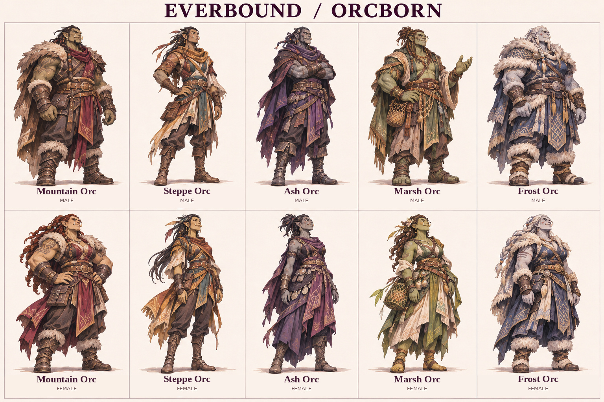
Orcborn lineages — approved reference art (male and female)

| Lineage | Identity / visual cues | Core specialty | Future skill-tree direction |
|---|---|---|---|
| **Mountain Orc** | Massive frame, heavy tusks, wide shoulders | Strength, durability | Powerful exertion, holding ground, resilience |
| **Steppe Orc** | Lean musculature, long limbs | Speed, stamina | Running, pursuit, sustained travel |
| **Ash Orc** | Grey or charcoal skin, weathered features | Heat and hazard resistance | Environmental endurance, hazardous-ground traversal |
| **Marsh Orc** | Broad hands and feet, green-toned skin variations | Swimming, resilience | Wetland survival, aquatic movement, tough footing |
| **Frost Orc** | Dense physique, pale grey skin variations | Cold tolerance, endurance | Winter survival, prolonged exertion |

**Design note:** An Orcborn lineage does not determine temperament, morality, or role.

## 8. Beastkin

**Base identity:** Humanlike faces, torsos, hands, and legs, with lineage-specific animal ears, animal-influenced eyes, and **one** appropriate tail. No animal muzzle, animal head, or second set of human ears.

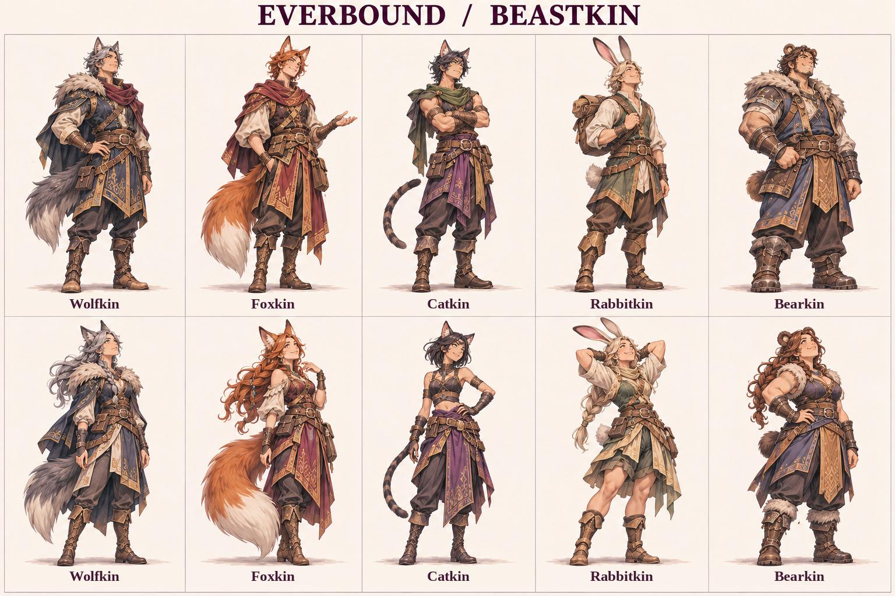
Beastkin lineages — approved reference art (male and female)

| Lineage | Identity / visual cues | Core specialty | Future skill-tree direction |
|---|---|---|---|
| **Wolfkin** | Wolf ears, bushy wolf tail | Tracking, pack coordination | Scent tracking, coordinated action, shared target awareness |
| **Foxkin** | Pointed fox ears, large fox tail | Cunning, deception, agility | Misdirection, rapid movement, reading intentions |
| **Catkin** | Cat ears, slender feline tail, keen eyes | Balance, reflexes, precision | Landing, evasive timing, precise movement |
| **Rabbitkin** | Long rabbit ears, small rabbit tail, strong legs | Jumping, speed, evasion | Leaping, sudden escapes, threat awareness |
| **Bearkin** | Rounded bear ears, small bear tail, sturdy frame | Strength, endurance, protection | Strength, defensive resilience, sheltering allies |

**Final selection:** Only these **five** Beastkin lineages. **Lionkin, Tigerkin, Deerkin, Otterkin, and Badgerkin are excluded** from the current playable roster.

## 9. Drakari

**Base identity:** Humanoid dragon descendants with scales on cheeks and forearms, swept-back horns, and slit pupils. No automatic wings or unrestricted breath weapons.

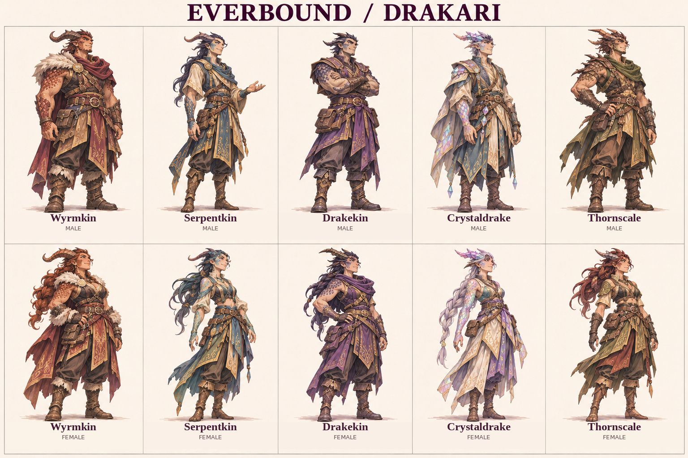
Drakari lineages — approved reference art (male and female)

| Lineage | Identity / visual cues | Core specialty | Future skill-tree direction |
|---|---|---|---|
| **Wyrmkin** | Heavy scales, broad horns, powerful frame | Strength, resilience | Physical endurance, heavy impacts, sturdy stance |
| **Serpentkin** | Fine scales, slender frame, swept horns | Agility, flexibility | Flowing movement, evasion, body control |
| **Drakekin** | Thick scales, pronounced brow ridges | Endurance, close combat | Melee pressure, guarding, physical resilience |
| **Crystaldrake** | Faceted scale patterns, crystalline horn ridges | Magical resonance, perception | Detecting magic, sensing disturbances, energy awareness |
| **Thornscale** | Raised scale ridges, pronounced horn structures | Defense, counterattacks | Guarding, counterforce, protective response |

**Design note:** Bronze, blue, ember-red, jade, and pearl scale colors are independent **appearance options**. Color does not dictate ancestry, affinity, or powers.

## 10. Ashborn

**Base identity:** Humanoids with curved horns, slender tails, ember-bright eyes, and ash-grey to crimson skin variations; not inherently evil.

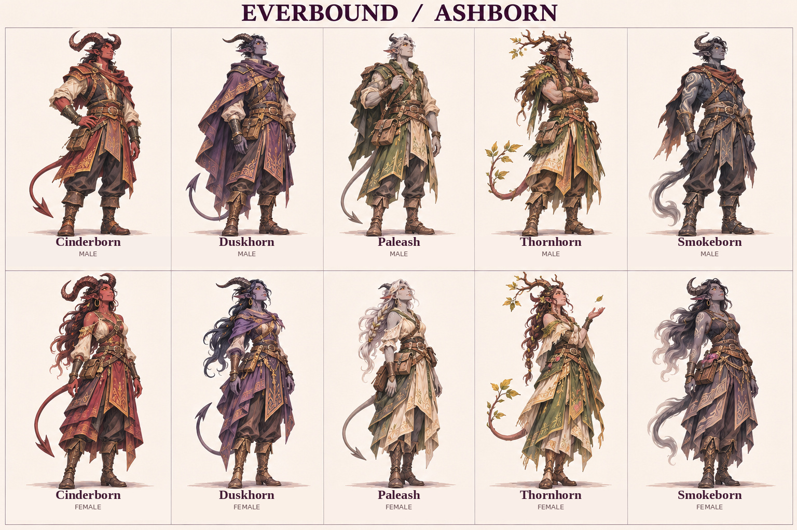
Ashborn lineages — approved reference art (male and female)

| Lineage | Identity / visual cues | Core specialty | Future skill-tree direction |
|---|---|---|---|
| **Cinderborn** | Crimson skin, prominent curved horns | Heat resistance | Heat and fire-hazard resilience |
| **Duskhorn** | Dark-violet skin, swept-back horns | Shadow perception | Low-light awareness, concealed-threat detection |
| **Paleash** | Pale grey skin, finer horns | Magical sensitivity | Sensing magic, arcane disturbances |
| **Thornhorn** | Branching horns, distinctive tail | Defensive resilience | Sturdy defense, reacting to contact |
| **Smokeborn** | Charcoal complexion, smoke-like markings | Concealment, environmental awareness | Cover, obscured terrain, hazard sensing |

**Design note:** Horn and tail morphology can vary, but default Ashborn anatomy never requires dragon scales or wings.

## 11. Sylph

**Base identity:** Light adult humanoids with translucent, veined **insectlike** gossamer wings and shimmering freckles. Wings enable controlled gliding rather than unrestricted flight.

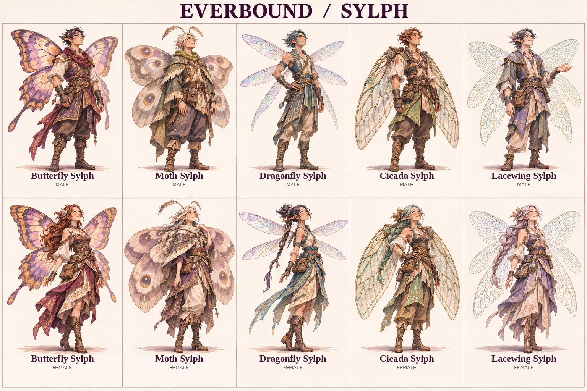
Sylph lineages — approved reference art (male and female)

| Lineage | Identity / visual cues | Core specialty | Future skill-tree direction |
|---|---|---|---|
| **Butterfly Sylph** | Broad, patterned translucent wings | Grace, visual misdirection | Gliding, wing-display distractions, graceful movement |
| **Moth Sylph** | Rounded wing shapes, soft markings, optional antennae | Night senses, concealment | Darkness awareness, quiet movement |
| **Dragonfly Sylph** | Four narrow gossamer wings, slender frame | Rapid movement, reflexes | Direction changes, evasion, controlled descent |
| **Cicada Sylph** | Strongly veined wings, distinct wing-root markings | Vibration and sound sensing | Acoustic awareness, vibration detection |
| **Lacewing Sylph** | Delicate, intricate transparent wing veining | Precision, controlled gliding | Fine flight control, precise positioning |

**Design note:** Preserve Sylph's wing-based physical identity across every lineage. Never substitute feathered Skyborn wings.

## 12. Tidekin

**Base identity:** Amphibious-looking humanoids with neck gills, webbed fingers, finlike ears, and iridescent scale patches. Two legs and feet—not mermaid tails.

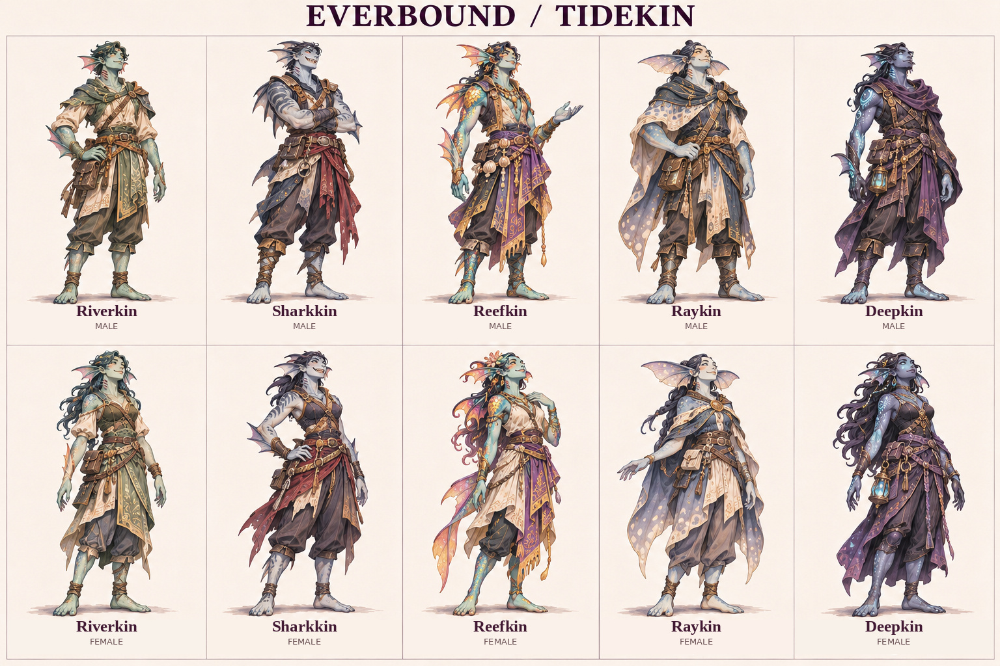
Tidekin lineages — approved reference art (male and female)

| Lineage | Identity / visual cues | Core specialty | Future skill-tree direction |
|---|---|---|---|
| **Riverkin** | Subtle freshwater scale patterns, compact fins | River navigation, current sensing | Navigating currents, swimming, freshwater survival |
| **Sharkkin** | Sharklike fin styling, sharper teeth | Predator senses, strength | Detecting movement, physical pursuit, aquatic awareness |
| **Reefkin** | Bright scale patterns, ornamental fins | Camouflage, environmental awareness | Blending with surroundings, reefs and shoreline navigation |
| **Raykin** | Broad finlike ear structures, flattened scale patterns | Fluid movement, defense | Flowing repositioning, defensive turning |
| **Deepkin** | Dark scales, subtle bioluminescent markings | Low-light vision, pressure tolerance | Deep-water awareness, darkness adaptation |

**Final selection:** Only these **five** Tidekin lineages. **Eelkin is removed** from the playable roster.

**Design note:** Tidekin traits need useful applications during land-based adventures; water should improve their options, not be mandatory.

## 13. Skyborn

**Base identity:** Avian humanoids with **full bird heads** (beak, avian eyes and a feathered crest, matching the approved lineage art), feathered wings behind their shoulders, two arms, two legs, and avian feet. Wing-assisted movement does **not** mean unrestricted flight.

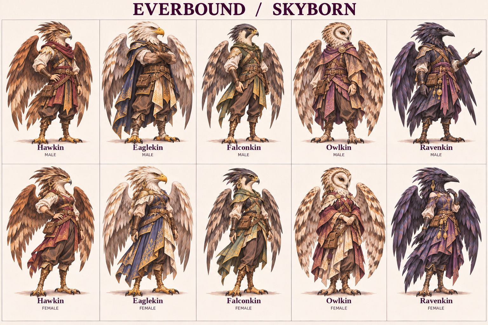
Skyborn lineages — approved reference art (male and female)

| Lineage | Identity / visual cues | Core specialty | Future skill-tree direction |
|---|---|---|---|
| **Hawkin** | Hawk-inspired crest, strong wings, sharp eyes | Tracking, aerial positioning | Long sightlines, surveying terrain, positional movement |
| **Eaglekin** | Broad wings, powerful build, prominent crest | Strength, distant vision | Long-range perception, soaring control, powerful positioning |
| **Falconkin** | Streamlined wings, lean frame | Speed, precision | Rapid descent, accuracy, reactive movement |
| **Owlkin** | Rounded feather patterns, broad wings, owl features | Night vision, silent movement | Low-light detection, quiet gliding, stealth |
| **Ravenkin** | Ravenlike plumage and crest, expressive eyes | Intelligence, memory | Observation, recall, clever tactics |

**Final selection:** Only these **five** Skyborn lineages. **Crowkin, Heronkin, Kingfisherkin, Vulturekin, and Albatrosskin are excluded** from the current playable roster.

## 14. Forgeborn

**Base identity:** Awakened souls in clearly constructed humanoid bodies, with a visible chest core gem and rune seams. Magical craftsmanship rather than science-fiction robotics.

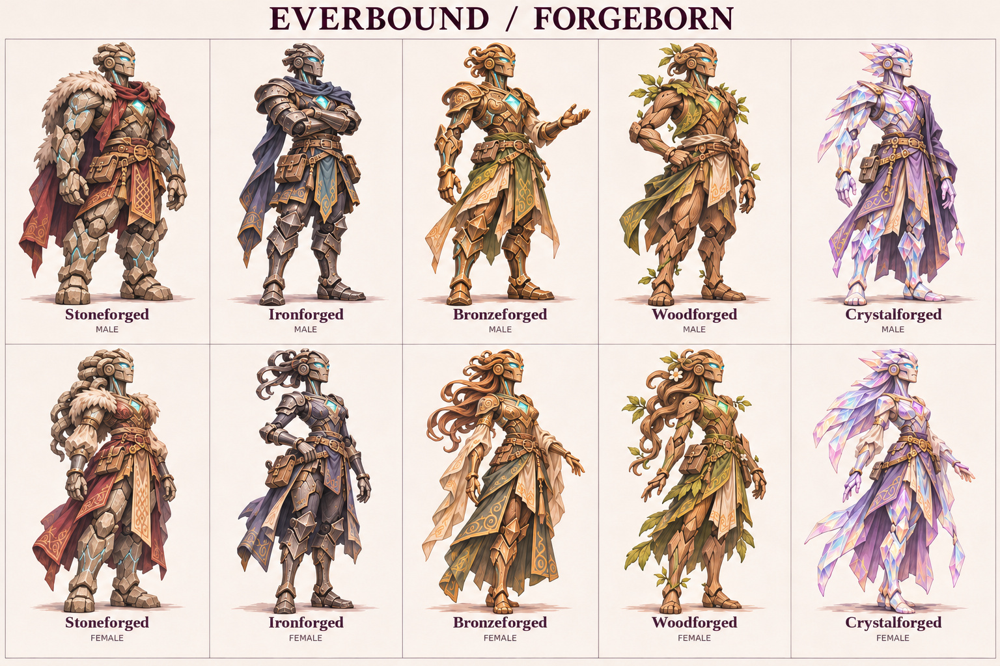
Forgeborn lineages — approved reference art (male and female)

| Lineage | Identity / visual cues | Core specialty | Future skill-tree direction |
|---|---|---|---|
| **Stoneforged** | Carved stone body, heavy joints | Physical durability | Fortification, structural stability, damage resilience |
| **Ironforged** | Forged iron plates, reinforced joints | Strength, defense | Heavy exertion, guarding, sturdy stance |
| **Bronzeforged** | Bronze plates, intricate crafted details | Precision, adaptability | Accurate manipulation, coordination, flexible mechanisms |
| **Woodforged** | Livingwood or carved timber body | Regeneration, nature affinity | Natural renewal, wood-based resilience, repair |
| **Crystalforged** | Crystal facets, translucent constructed sections | Magical energy sensitivity | Resonance, magical perception, power regulation |

**Design note:** All Forgeborn retain constructed faces/bodies and visible core gems. Any effects on healing, poison, exhaustion, and repair must be explicitly balanced in the rules rather than assumed.

---

## 15. Implementation rules for the character creator

1. **Race first:** Player selects one of 12 base races.
2. **Lineage second:** Player selects one of exactly five lineages for that race.
3. **Appearance:** Player customizes appearance within approved race/lineage anatomy (including scale/feather/material colors where appropriate).
4. **Class:** Player selects one of the six official, fixed classes: Vanguard, Wildstrider, Shadowblade, Luminary, Arcanist, Resonant.
5. **Class specialization:** Class advancement follows the existing class-specialization rules.
6. **Racial skill tree:** A separate progression tree tied to the selected lineage, added in a future design phase.
7. **No restrictions by lineage:** All 60 lineages can play all six classes; no custom classes or lineage-locked classes.
8. **Cross-table consistency:** The same character lineage and physical traits persist across Everbound sessions and online character profiles.

## 16. Racial-skill-tree development template

For each lineage, future design should specify:

| Field | Definition |
|---|---|
| Core identity | What makes this lineage visually and thematically distinct |
| Innate trait | One modest, immediately recognizable starting feature |
| Mechanical niche | Specialty that complements—but does not replace—a class |
| Racial skill branches | Two or three coherent directions based on the lineage's ancestry |
| Active skills | Limited-use actions unlocked through racial progression |
| Passive skills | Modest improvements to natural strengths |
| Capstone | A high-tier expression of lineage mastery |
| Exploration use | Meaningful benefit outside combat |
| Constraints | Clear boundaries to prevent overpowered mobility, defenses, or utility |
| Art direction | Approved anatomy, silhouette, and appearance variables |

**Balance guardrails:** No unrestricted starting flight; no automatic elemental powers based solely on color; no lineage should require a particular terrain to remain playable; no lineage should invalidate another class's central role.

---

## 17. Locked roster decisions and change log

**Approved roster adjustments:**

- Beastkin reduced to **Wolfkin, Foxkin, Catkin, Rabbitkin, Bearkin**.
- Skyborn reduced to **Hawkin, Eaglekin, Falconkin, Owlkin, Ravenkin**.
- Tidekin reduced to **Riverkin, Sharkkin, Reefkin, Raykin, Deepkin**; **Eelkin removed**.
- Every other base race retains the five ancestries/heritages previously proposed.
- Total roster standardized to **12 × 5 = 60 lineages**.

**Next step:** Design detailed racial skill trees for the 60 lineages, using this roster as the naming and identity reference.

---

*EVERBOUND — The Living Adventurers Guild · Racial Lineage Compendium v1.0*

---

